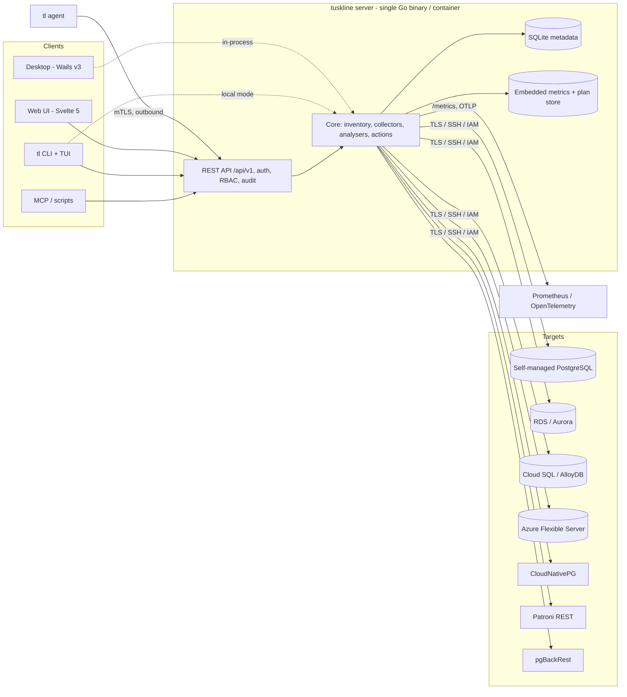
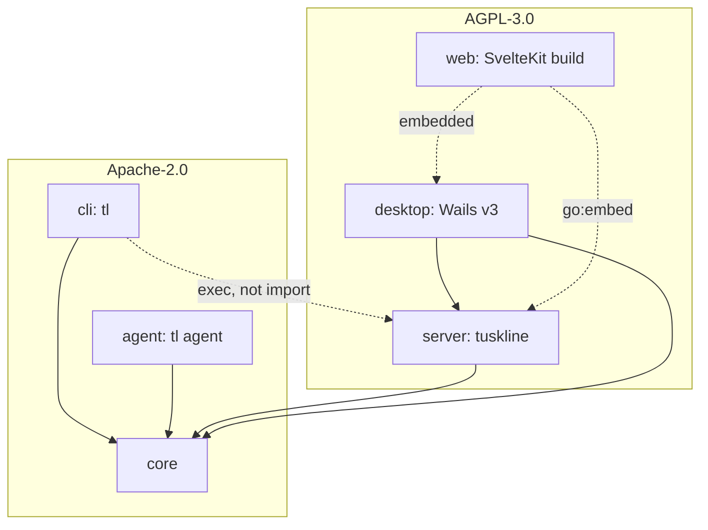
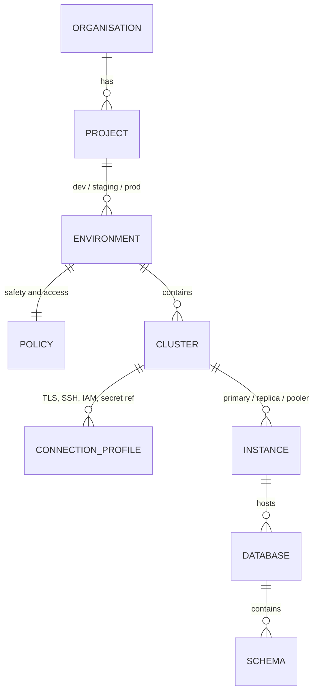
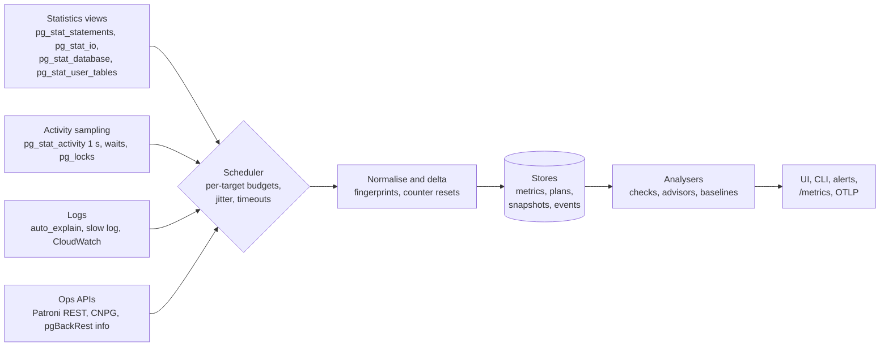

# Architecture

One Go core with four surfaces. The core holds all PostgreSQL knowledge; the surfaces render it.

## System



gRPC and the WASM plugin host from the original design are on the cut list ([0008](adr/0008-solo-founder-scope.md)). The API is REST only, with an OpenAPI spec.

## Modules and licences



| Module | Path | Purpose |
|---|---|---|
| core | `core/` | `version`, `inventory`, `conn`, `activity` (live sessions, waits, locks, blocking chains), `collector`, `sqlpack`, `analyser`, `advisor`, `lint`, `provision`, `store`; `pgtest` (integration-test containers only) |
| cli | `cli/cmd/tl`, `cli/internal/cmd` | Cobra commands; TUI (Bubble Tea) for `tl top` |
| agent | `agent/` | Outbound collector for networks the server cannot reach; OS metrics and log tailing |
| server | `server/cmd/tuskline`, `server/internal/{httpapi,webui}` | Multi-user API, RBAC, history, alerting; embeds the web build |
| web | `web/` | SvelteKit SPA |
| desktop | `desktop/` | Wails v3 host (M8) |

## Inventory model



- CLI references use `environment/cluster`, for example `prod/orders` (`inventory.ParseRef`).
- Environment kinds are `local`, `dev`, `staging` and `prod`. Each has a policy (`inventory.DefaultPolicy`). Prod defaults to read-only with a 30 s statement timeout, a 2 s lock timeout, a 1,000-row limit, typed confirmation and a maximum elevation of 15 min.
- **Local inventory file** (M1.3): `$XDG_CONFIG_HOME/tuskline/inventory.yaml`, falling back to the OS config directory; `TUSKLINE_INVENTORY` overrides the path. It lists environments (name and kind) and clusters (connection profile, provider, last probe). Saves are atomic, with mode 0600 in a 0700 directory.
  - Passwords are stored only as references (`password: {env: ORDERS_PASSWORD}`; `{keychain: …}` is reserved for M8.3). A plaintext value, a password inside the profile or an unknown key fails to load, and the error never repeats the value.
  - Policies are never read from the file: each environment always gets `DefaultPolicy(kind)`, so editing the file cannot weaken prod.

```yaml
version: 1
environments:
  - name: prod
    kind: prod
clusters:
  - name: orders
    environment: prod
    provider: rds
    profile: {host: orders.example.com, database: orders, user: app}   # sslmode defaults to verify-full
    password: {env: ORDERS_PASSWORD}
```

## Data collection pipeline



- Agentless by default, using the least-privilege `tuskline_monitor` role (`pg_monitor`). Collectors respect a per-target query-time budget and back off under load.
- SQL packs are versioned per PostgreSQL major. Each metric is documented with its source view. They degrade gracefully when an extension is missing, and say what installing it would add.
- **Retention defaults:** raw 1 s activity for 1 hour, 1 min rollups for 14 days, 1 h rollups for 13 months.

## Storage

- **Metadata:** embedded SQLite (pure-Go driver) in a volume or the user's config directory. Teams that need HA can use an external PostgreSQL.
- **Metrics history:** Parquet segments on disk, written and read from `core` with a pure-Go library, with downsampling and the retention defaults in [ADR 0013](adr/0013-metrics-storage.md). The desktop app may also query the files with DuckDB (M8). Remote write is an export, not the store. Exploring DuckLake for the archive is on the R3 list.

## Deployment modes

| Mode | How | Who |
|---|---|---|
| Laptop | Desktop app, `brew install`, or `docker run` with SQLite in a volume | Developers, consultants |
| Team server | One container behind SSO; PostgreSQL for metadata optional | Small teams |
| Fleet | Server plus agents in each VPC or cluster | Platform teams |
| Kubernetes | Helm chart; reads operator resources in-cluster | Teams on CNPG |
| Cloud | Tuskline Cloud plus outbound agents | Teams that do not want to host it |
| Air-gapped | Offline image, local models for AI features | Regulated environments |

## Request path (server)

`tuskline serve` → `httpapi.New` → `/api/v1/*` (JSON) plus the embedded SPA (`webui`), with fallback to `index.html`. Security headers are set on every response. Auth, RBAC and audit middleware arrive in M3 and M9. The desktop app mounts the same handler in-process.
